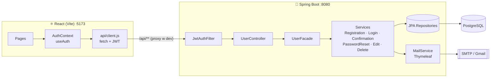
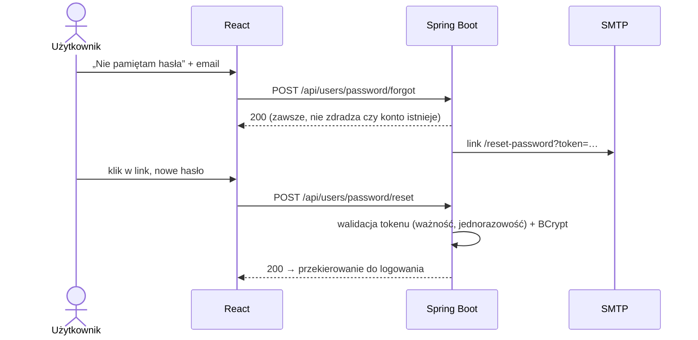

<div align="center">

# 🧩 UserBridge

### Gotowy fundament full-stack pod każdą nową aplikację

**Spring Boot 3 · Spring Security + JWT · PostgreSQL · React 18 · Vite**


</div>

---

## 💡 Po co ten projekt?

Każda aplikacja zaczyna się tak samo: rejestracja, aktywacja konta mailem, logowanie, „nie pamiętam hasła”, profil użytkownika, role. To zwykle **pierwsze 2–3 tygodnie pracy**, które nic nie wnoszą do samego pomysłu na produkt.

**UserBridge to klocek startowy, który robi to raz i porządnie.** Kiedy zaczynam nową aplikację, klonuję repozytorium, uzupełniam `.env` i po kilku minutach mam działający backend i frontend z pełną obsługą użytkowników. Od pierwszego dnia piszę już tylko to, co jest specyficzne dla nowego projektu.

> 🎯 **Jedno `git clone` i od razu piszesz funkcje produktu, a nie kolejne logowanie.**

---

## ✨ Co dostajesz od razu

| | Funkcja | Szczegóły |
|---|---|---|
| 📝 | **Rejestracja** | walidacja danych (Bean Validation), hasła hashowane BCryptem |
| 📧 | **Aktywacja konta mailem** | jednorazowy token, szablon HTML (Thymeleaf), wysyłka przez SMTP |
| 🔐 | **Logowanie JWT** | bezstanowe sesje, filtr `JwtAuthFilter`, nieaktywne konto nie zaloguje się |
| 🔁 | **Reset hasła** | link ważny 30 min, **jednorazowy**, nowy link unieważnia poprzedni, brak *user enumeration* |
| 👤 | **Profil** | `GET /me`, edycja danych, usunięcie konta |
| 🛡️ | **Role i własność zasobów** | `ROLE_USER` / `ROLE_ADMIN`, `@PreAuthorize`: użytkownik edytuje i usuwa **tylko siebie** |
| 🌐 | **CORS** | dozwolone originy konfigurowane z `.env` |
| ⚛️ | **Frontend React** | wszystkie ekrany gotowe: logowanie, rejestracja, aktywacja, reset hasła, profil, panel admina |
| 🔑 | **Sekrety w `.env`** | `application.properties` zawiera tylko placeholdery, więc żadne hasło nie trafia do repo |
| 🐳 | **Baza jednym poleceniem** | Spring Boot sam uruchamia PostgreSQL z `compose.yaml` |
| 📄 | **Swagger UI** | dokumentacja API pod `/swagger-ui.html` |
| 🧪 | **76 testów** | JUnit 5, Mockito, MockMvc, Spring Security Test, H2 |

---

## 🏗️ Architektura



Backend ma czytelny podział **domain / infrastructure**. Kontroler zna tylko fasadę `UserFacade`, a każdy przypadek użycia ma osobny serwis. Nowy moduł (np. `domain/order`) dodajesz obok, nie ruszając części odpowiedzialnej za użytkowników.

### Przepływ resetu hasła



---

## 🚀 Start w 3 krokach

**Wymagania:** Java 17+, Node 18+, Docker

```bash
# 1. Konfiguracja: skopiuj szablon i uzupełnij sekrety (JWT, SMTP)
cp .env.example .env

# 2. Backend: PostgreSQL wstaje automatycznie z compose.yaml
./mvnw spring-boot:run

# 3. Frontend
cd frontend && npm install && npm run dev
```

Otwórz **http://localhost:5173** i zarejestruj konto. Link aktywacyjny przyjdzie mailem.

| Adres | Co tam jest |
|---|---|
| http://localhost:5173 | aplikacja React |
| http://localhost:8080/swagger-ui.html | dokumentacja API |

---

## 🧱 Jak zacząć z tego nową aplikację

1. `git clone` → zmień nazwę repo i `VITE_APP_NAME` w `frontend/.env`
2. Uzupełnij `.env` (własny `JWT_SECRET`, dane SMTP, nazwa bazy)
3. **Backend:** dodaj swój moduł obok `domain/user`, np. `domain/project`. Endpointy są domyślnie chronione (`anyRequest().authenticated()`), a do sprawdzania własności zasobu użyj `@PreAuthorize`
4. **Frontend:** dopisz endpointy w `src/api/`, a strony umieść w chronionej grupie tras w `src/App.jsx`:

```jsx
<Route element={<ProtectedRoute />}>
  <Route path="/" element={<DashboardPage />} />
  <Route path="/projects" element={<ProjectsPage />} />   {/* ← Twoja nowa funkcja */}
</Route>
```

Zalogowany użytkownik jest dostępny w każdym komponencie:

```jsx
const { user, isAdmin, logout } = useAuth();
```

---

## 🔌 REST API

| Metoda | Endpoint | Dostęp | Opis |
|---|---|---|---|
| `POST` | `/api/users/register` | publiczny | rejestracja + mail aktywacyjny |
| `GET` | `/api/users/confirm?token=` | publiczny | aktywacja konta |
| `POST` | `/api/users/login` | publiczny | zwraca JWT |
| `POST` | `/api/users/password/forgot` | publiczny | wysyła link resetu hasła |
| `POST` | `/api/users/password/reset` | publiczny | ustawia nowe hasło na podstawie tokenu |
| `GET` | `/api/users/me` | zalogowany | profil + role bieżącego użytkownika |
| `PUT` | `/api/users/{id}` | właściciel / admin | edycja profilu |
| `DELETE` | `/api/users/{id}` | właściciel / admin | usunięcie konta |
| `GET` | `/api/users` | admin | lista użytkowników |

---

## ⚙️ Konfiguracja (`.env`)

Wszystkie wartości zależne od środowiska są w jednym pliku `.env`, z którego korzysta i Spring Boot (`spring.config.import`), i Docker Compose. W `application.properties` zostają tylko placeholdery `${...}`. Na produkcji te same nazwy ustawiasz jako zwykłe zmienne środowiskowe.

| Zmienna | Opis |
|---|---|
| `SERVER_PORT` | port backendu (domyślnie 8080) |
| `APP_FRONTEND_URL` | adres frontendu, używany w linkach w mailach |
| `APP_CORS_ALLOWED_ORIGINS` | originy dopuszczone przez CORS (po przecinku) |
| `JWT_SECRET`, `JWT_EXPIRATION_DAYS` | klucz podpisu i ważność tokenu |
| `DB_HOST`, `DB_PORT`, `DB_NAME`, `DB_USERNAME`, `DB_PASSWORD` | PostgreSQL |
| `MAIL_USERNAME`, `MAIL_PASSWORD` | SMTP (dla Gmaila: [hasło aplikacji](https://myaccount.google.com/apppasswords)) |
| `PASSWORD_RESET_EXPIRATION_MINUTES` | ważność linku resetu hasła |

Frontend ma własny `frontend/.env` (`VITE_API_URL`, `VITE_API_PROXY_TARGET`, `VITE_APP_NAME`). W trybie dev Vite przekazuje `/api` do backendu, więc lokalnie nie trzeba konfigurować CORS.

---

## 🔒 Decyzje dotyczące bezpieczeństwa

- **Hasła:** BCrypt, nigdy nie są zwracane przez API
- **Brak user enumeration:** `/password/forgot` zawsze odpowiada tak samo
- **Tokeny resetu:** UUID, ważne przez krótki czas, jednorazowe, usuwane razem z kontem (`ON DELETE CASCADE`)
- **Autoryzacja na poziomie zasobu:** `@PreAuthorize("@userAccess.isSelfOrAdmin(#id)")`
- **Domyślnie zamknięte:** wszystko poza listą publicznych endpointów wymaga JWT
- **Nieprawidłowy lub wygasły JWT:** żądanie traktowane jako anonimowe (401), nigdy jako błąd 500
- **Sekrety:** tylko w `.env`, który jest w `.gitignore`

---

## 🧪 Testy

```bash
./mvnw test
```

**76 testów** jednostkowych i integracyjnych: serwisy domenowe (Mockito), kontrolery i obsługa błędów (MockMvc + Spring Security Test), repozytoria (H2), wysyłka maili i JWT. Testy nie potrzebują `.env` ani Dockera, więc działają od razu w CI.

---

## 📁 Struktura

```
UserBridge/
├── src/main/java/com/example/userbridge/
│   ├── domain/user/            # logika biznesowa: encje, DTO, serwisy, fasada, wyjątki
│   └── infrastructure/
│       ├── api/                # REST controllers + GlobalExceptionHandler
│       ├── security/           # SecurityConfig, JwtAuthFilter, JwtService, UserAccess
│       ├── repository/         # Spring Data JPA
│       └── service/            # MailService
├── src/main/resources/templates/  # maile HTML (aktywacja, reset hasła)
├── frontend/
│   └── src/
│       ├── api/                # client.js (fetch + JWT + błędy), userApi.js
│       ├── auth/               # AuthContext (useAuth), ProtectedRoute
│       ├── components/         # Layout, FormField, Alert, AuthCard, Spinner
│       └── pages/              # Login, Register, Confirm, Forgot/ResetPassword, Dashboard, Profile, Admin
├── compose.yaml                # PostgreSQL dla dev
└── .env.example                # szablon konfiguracji
```

---

## 🗺️ Roadmap

- [ ] Refresh tokeny i wylogowanie po stronie serwera
- [ ] Logowanie przez Google / GitHub (OAuth2)
- [ ] Migracje bazy (Flyway) zamiast `ddl-auto`
- [ ] Dockerfile dla backendu i frontendu + pipeline CI
- [ ] Zarządzanie rolami z panelu admina

---

<div align="center">

**Autor: Przemysław Włodarczyk** · [GitHub](https://github.com/przemyslawwlodarczyk90)

*Napisane raz, używane przy każdym kolejnym projekcie.* 🧩

</div>
